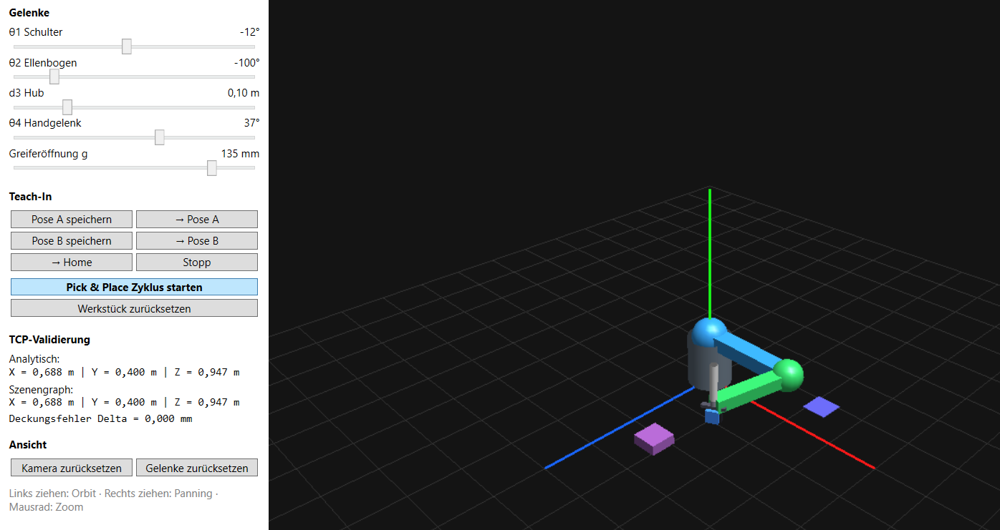

# Termin 05 – Track A: 4-Achs-SCARA mit Parallelgreifer, Teach-In & Pick-and-Place

**Lehrveranstaltung:** Systemsimulation / Digitaler Zwilling  
**Studiengang:** B.Sc. Automatisierungstechnik, 5. Semester, FH OÖ Campus Wels  
**Technologie:** C# 12 / .NET 8, WPF, SharpGL.WPF 3.1.1 (Fixed-Function OpenGL), single-threaded (`DispatcherTimer`)

3D-Fertigungszelle mit einem SCARA-Roboter: Die Kinematik wird vollständig über einen hierarchischen Szenengraphen und den OpenGL-Matrix-Stack abgebildet. Ein Parallelgreifer an Achse 4 transportiert ein Werkstück per animiertem Teach-In von Station A nach Station B.

---

## 1. Bedienung

| Element | Funktion |
| :--- | :--- |
| Linke Maustaste ziehen | Orbit-Kamera (Azimut $\theta$, Elevation $\varphi$, geklemmt auf $\pm 85°$) |
| Rechte Maustaste ziehen | Panning des Kamera-Zielpunkts quer zur Blickrichtung |
| Mausrad | Zoom (Kameraabstand $r$) |
| Slider $\theta_1, \theta_2, d_3, \theta_4, g$ | Gelenke direkt verstellen, eine laufende Bahnfahrt wird dabei abgebrochen |
| Pose A / B speichern | aktuelle Gelenkstellung als Teach-Pose übernehmen |
| → Pose A / → Pose B / → Home | animierte Fahrt zur gespeicherten Pose |
| Pick & Place Zyklus starten | vollautomatischer Transport Station A → Station B |
| Werkstück zurücksetzen | Werkstück wieder auf Station A stellen |
| TCP-Validierung | analytischer TCP, TCP aus dem Szenengraphen und Deckungsfehler $\Delta$ |
| Statuszeile | Abstand $d$, Werkstückzustand (frei / greifbar / gegriffen), Greiferorientierung, aktuelles Bahnsegment |

---

## 2. Aufbau

| Klasse | Aufgabe |
|---|---|
| `SceneNode` | Knoten des Szenengraphen: lokale Translation, Rotation und Skalierung, Kindknoten, Geometrie über `RenderCustomGeometry`. `Render()` zeichnet rekursiv über `PushMatrix`/`PopMatrix`, `GetWorldPosition()` berechnet die Weltlage über die Matrizen aller Elternknoten |
| `OrbitCamera` | Kamera auf einer Kugelschale um den Zielpunkt, Umrechnung in die Augposition und `gl.LookAt`, dazu `Rotate`, `Zoom` und `Pan` |
| `JointPose` | Gelenkkonfiguration $(\theta_1, \theta_2, d_3, \theta_4, g)$ als `record struct` mit `Lerp()` für die Interpolation |
| `MainWindow` | Aufbau des Szenengraphen, Rendering, Teach-In-Steuerung, Greiflogik, Mausbedienung |

Track A ist ein eigenes Projekt (`SceneGraph3D.TrackA`) in der Projektmappe. Stufe 1 bleibt im Projekt `SceneGraph3D`, die Unit-Tests in `SceneGraph3D.Tests` beziehen sich auf dieses Projekt.

---

## 3. Stufe 1 – Basisaufgabe

| Aufgabe | Umsetzung |
|---|---|
| 1.1 Szenengraph-Rendering | jeder Knoten zeichnet seine Geometrie über `RenderCustomGeometry`, `RenderRobot()` besteht nur noch aus `_rootNode.Render(gl)`. Die Skalierung der Armsegmente steht lokal innerhalb von `PushMatrix`/`PopMatrix`, sonst würden alle Kindknoten mitverzerrt. Deckungsfehler bleibt $\Delta = 0{,}000$ mm |
| 1.2 Kamera-Panning | `OrbitCamera.Pan()` verschiebt den Zielpunkt quer zur horizontalen Blickrichtung, rechte Maustaste mit Faktor 0,01 m/px |
| 1.3 Werkstück | Würfel mit 0,12 m Kante bei $(1{,}10;\ 0{,}06;\ -0{,}40)$ m, 3D-Abstand zum TCP in der Statusleiste, grün bei $d < 0{,}12$ m |
| 1.4 Test | Pan-Assertions in `Test_SceneNode_Reparenting_And_OrbitCamera_Pan` einkommentiert |

Panning-Formel (Verschiebung quer zur Blickrichtung, die Szene folgt der Maus):

$$\Delta x_{look} = -\Delta_{right}\cos\theta, \qquad \Delta z_{look} = +\Delta_{right}\sin\theta, \qquad \Delta y_{look} = \Delta_{up}$$

`dotnet test`: alle 6 Unit-Tests bestanden (Kugelkoordinaten, Gimbal-Lock-Clamping, SCARA-Vorwärtskinematik, Matrix-Hierarchie, Reparenting + Panning, Symmetrie der Greiferbacken).

---

## 4. Szenengraph & Vorwärtskinematik

```
Root
├── Base                         Zylinder, H = 0,5 m
│   └── UpperArm   T(0, H, 0)·Ry(θ1)         Schulter + Arm 1 (L1 = 1,0 m)
│       └── ForeArm   T(L1, 0, 0)·Ry(θ2)     Ellenbogen + Arm 2 (L2 = 0,8 m)
│           └── Pinole   T(L2, −d3, 0)       Pinolenschaft
│               └── Wrist   Ry(θ4)          Flansch + Querbalken (y = +0,06 m)
│                   ├── LeftFinger    T(0, 0,06, −g/2)
│                   ├── RightFinger   T(0, 0,06, +g/2)
│                   └── TCP           T(0, 0, 0)   (── Workpiece, wenn gegriffen)
├── StationA   (1,10; 0; −0,40)  Bodenmarkierung
├── StationB   (0,40; 0; 1,10)   Plattform, Höhe 0,10 m
└── Workpiece  Würfel 0,12 m     (hier, wenn abgelegt)
```

Jeder Knoten führt beim Rendern `PushMatrix → Translate/Rotate → Geometrie → Kinder → PopMatrix` aus. Die Weltlage eines Gliedes ergibt sich so automatisch aus allen vorherigen Gelenkstellungen, **Weltkoordinaten werden nirgends manuell berechnet**.

**Analytische Vorwärtskinematik** zur Kontrolle (gelbe Kugel). Der TCP liegt im Ursprung der Pinole, der Greifer ist um diesen Punkt zentriert:

$$x = L_1\cos\theta_1 + L_2\cos(\theta_1+\theta_2)$$
$$z = -\big(L_1\sin\theta_1 + L_2\sin(\theta_1+\theta_2)\big)$$
$$y = H_{Base} - d_3$$

Das negative Vorzeichen bei $z$ folgt aus der Drehrichtung von `gl.Rotate` um die Y-Achse: Ein positiver Winkel dreht $+x$ in Richtung $-z$.

Die Greiferorientierung um die Hochachse ist $\psi = \theta_1 + \theta_2 + \theta_4$. Achse 4 dreht um die vertikale Achse durch den TCP und ändert daher **nur die Orientierung, nicht die Position**.

**Validierung:** TCP-Kugel (analytisch) und `_tcpNode.GetWorldPosition()` (Szenengraph-Matrix) decken sich in allen Stellungen und während der gesamten Bahnfahrt mit $\Delta = 0{,}000$ mm.

---

## 5. Track A – Greifer, Teach-In & Pick-and-Place

* **A.1 Achse 4 & Parallelgreifer:** `_wristNode` mit $\theta_4 \in [-180°;\ 180°]$ unter der Pinole. Die Backen `_leftFingerNode` und `_rightFingerNode` sitzen symmetrisch bei $T_z = \pm g/2$ mit $g \in [0{,}02;\ 0{,}16]$ m im lokalen System des Handgelenks und drehen sich dadurch ohne Zusatzrechnung mit. Die rote Platzhalter-Kugel aus Stufe 1 ist durch Querbalken und Backen ersetzt.

* **A.2 Teach-In:** Drei Posen (A, B, Home), A und B können per Button neu gespeichert werden. Ein `DispatcherTimer` mit ca. 60 Hz interpoliert alle fünf Gelenkwerte im Gelenkraum. Der Fortschritt wird kubisch geglättet:

  $$s_c = 3s^2 - 2s^3, \qquad q(t) = q_{start} + s_c\,(q_{ziel} - q_{start})$$

  Die Geschwindigkeit ist damit an Start und Ziel null, der Roboter fährt ohne Sprung an und bremst weich ab. Die Segmentdauer richtet sich nach der größten Gelenkbewegung (90°/s, Hub und Greifer 0,25 m/s), sodass alle Achsen gleichzeitig ankommen. Die Zeit wird über eine `Stopwatch` gemessen, nicht über die Anzahl der Ticks.

* **Standardposen:** A und B sind über die inverse Kinematik vorberechnet (Ellenbogen-unten-Lösung, $\theta_2 = -99{,}72°$). $\theta_4 = 37{,}38°$ ist so gewählt, dass $\psi$ ein Vielfaches von 90° ist und die Backen parallel zu den Würfelflächen stehen.

  | Pose | $\theta_1$ | $\theta_2$ | $d_3$ | $\theta_4$ | TCP-Höhe |
  |---|---|---|---|---|---|
  | A (Aufnahme) | 62,34° | −99,72° | 0,44 m | 37,38° | 0,06 m |
  | B (Ablage) | −27,66° | −99,72° | 0,34 m | 37,38° | 0,16 m |
  | Home | 0° | 0° | 0,10 m | 0° | 0,40 m |

* **Zyklus:** Home → über A → absenken → greifen → anheben → über B → absenken → ablegen → abheben → Home.

* **A.3 Greiflogik:**

  $$d = \lVert p_{TCP} - p_{WP} \rVert < r_{grab} = 0{,}06\ \text{m}$$

  $r_{grab}$ entspricht der halben Kantenlänge, der TCP muss also im Werkstück liegen. Gegriffen wird nur beim **Schließvorgang** (Flanke $g > 0{,}14 \rightarrow g \le 0{,}14$ m). Ein bereits geschlossener Greifer, der in das Werkstück fährt, greift nicht.

  **Reparenting:** Beim Greifen wird das Werkstück von `Root` unter den `TCP`-Knoten umgehängt und folgt ab dann automatisch der Kette. Die Weltorientierung bleibt erhalten (lokales $R_y = \psi_{WP} - \psi$). Beim Öffnen wird es mit seiner Weltlage zurück unter `Root` gehängt und rastet über einer Station (Radius 0,15 m) auf deren Auflagefläche ein, sonst landet es auf dem Hallenboden.

  Hält der Greifer ein Werkstück, schließen die Backen nur bis zur Kontaktbreite:

  $$g_{kontakt} = a + t = 0{,}12 + 0{,}015 = 0{,}135\ \text{m}$$

---

## 6. Beleuchtung & Kamera

**Phong-Beleuchtung** über `GL_LIGHT0`:

$$I = I_a k_a + I_d k_d\,\max(0,\ \vec n\cdot\vec l) + I_s k_s\,\max(0,\ \vec r\cdot\vec v)^{\alpha}$$

* Die Grundfarbe kommt über `GL_COLOR_MATERIAL` (ambient + diffus).
* Für sichtbare Glanzpunkte ist ein spekulares Material mit $k_s = 0{,}6$ und Shininess $\alpha = 40$ gesetzt. Der OpenGL-Standard ist $k_s = 0$, die Vorlage zeigt daher keine Glanzpunkte.
* `GL_NORMALIZE`: Die Quader entstehen über ungleichmäßige Skalierung eines Einheitswürfels, dabei würden die Normalen ihre Länge 1 verlieren und die Beleuchtung verfälschen.
* Jede Fläche (Würfel, Kugel, Zylinder) übergibt mit `gl.Normal` ihre Normale. Bei der Kugel ist das der normierte Ortsvektor, beim Zylinder $(\cos\varphi,\ 0,\ \sin\varphi)$.

**Orbit-Kamera** in Kugelkoordinaten:

$$x_{eye} = x_{look} + r\cos\varphi\sin\theta, \qquad y_{eye} = y_{look} + r\sin\varphi, \qquad z_{eye} = z_{look} + r\cos\varphi\cos\theta$$

Bei $\varphi = \pm 90°$ wären Blickrichtung und Up-Vektor $(0, 1, 0)$ parallel, ihr Kreuzprodukt wäre der Nullvektor und das Bild würde kippen (Gimbal Lock). Die Elevation wird deshalb auf $\pm 85°$ begrenzt.

---

## 7. Didaktische Vorgreif-Sperre

Gemäß den Vorgaben für Termin 05:
* Ausschließlich **Fixed-Function-OpenGL** über SharpGL (`PushMatrix`, `PopMatrix`, `Translate`, `Rotate`, `Normal`), keine Shader.
* **Kein** Multithreading (`Parallel.For`), **keine** numerischen Gleichungslöser, **keine** S-Functions. Die Kinematik entsteht rein über Transformationsmatrizen, die Bahnfahrt timergesteuert im UI-Thread.

---

## 8. Grafische Nachweise

### Track A – Werkstück gegriffen, Fahrt zu Station B
Das Werkstück ist blau (gegriffen) und hängt im Szenengraphen unter dem TCP. Der Deckungsfehler zwischen analytischem TCP und Szenengraph beträgt 0,000 mm. Glanzpunkte sind auf den Gelenkkugeln sichtbar.



---

## 9. Modellannahmen und Grenzen

* **Keine inverse Kinematik zur Laufzeit:** Die Standardposen sind offline vorberechnet, weitere Posen werden über die Slider geteacht.
* **Interpolation im Gelenkraum:** Der TCP fährt dadurch keine Gerade, sondern eine Kurve. Für eine kartesische Bahn müsste in jedem Tick die inverse Kinematik gelöst werden.
* **Keine Kollisionsprüfung:** Ist der Greifer beim Schließen nicht über dem Werkstück, fahren die Backen durch den Würfel. Auch Roboter und Stationen werden nicht auf Kollision geprüft.
* **Vereinfachtes Greifen:** Das Werkstück springt beim Greifen auf den TCP (höchstens $r_{grab} = 6$ cm). Beim Ablegen ohne Station fällt es ohne Physik direkt auf den Boden.
* **Timer-Auflösung:** Der `DispatcherTimer` erreicht wegen der Windows-Timer-Auflösung (ca. 15,6 ms) keine exakten 60 Hz. Weil die Interpolation über die gemessene Zeit läuft, stimmt die Fahrdauer trotzdem, nur die Bildrate schwankt.
