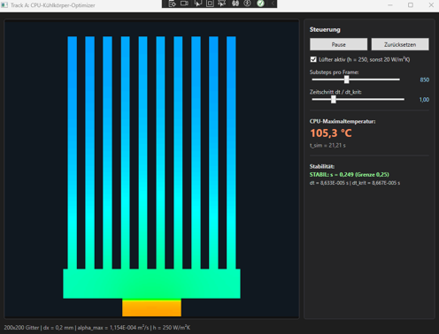
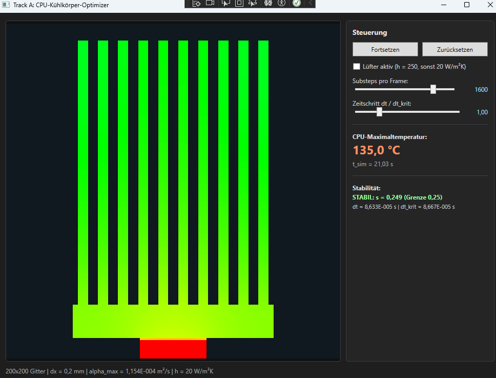
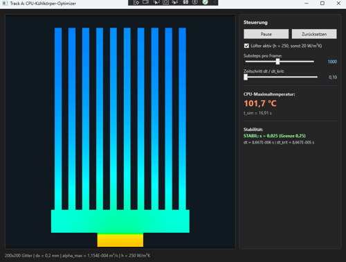
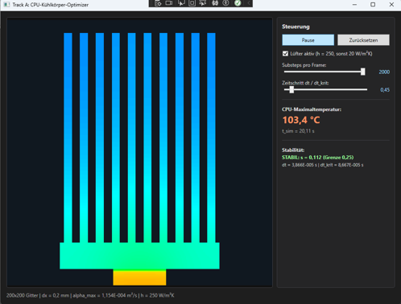
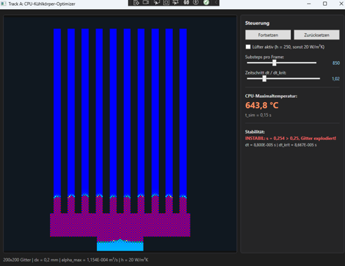
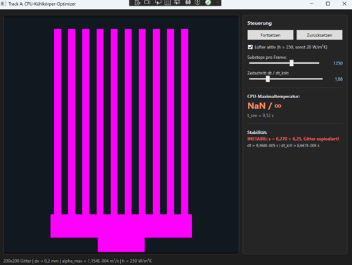

# Termin 02 – Track A: Server-Blade CPU-Kühlkörper-Optimizer (FDM & Robin-BC)

**Lehrveranstaltung:** Systemsimulation / Digitaler Zwilling  
**Studiengang:** B.Sc. Automatisierungstechnik, 5. Semester, FH OÖ Campus Wels  
**Technologie:** C# 12 / .NET 8, WPF, `WriteableBitmap`, single-threaded (`DispatcherTimer`)

Zweidimensionale Wärmeleitungssimulation eines CPU-Kühlers (Silizium-Die, Wärmeleitpaste, Kupfer-Heatspreader, 10 Aluminium-Finnen) mit expliziter Finite-Differenzen-Methode, Robin-Randbedingung für die Luftkühlung und umschaltbarem Lüfterausfall.

---

## 1. Bedienung

| Element | Funktion |
| :--- | :--- |
| Start / Pause / Zurücksetzen | startet und stoppt die Simulation, setzt alle Temperaturen auf 25 °C |
| Lüfter aktiv | $h = 250\,\text{W/(m²K)}$ (Normalbetrieb), abgewählt: $h = 20\,\text{W/(m²K)}$ (Lüfterausfall) |
| Substeps pro Frame | Anzahl der Rechenschritte zwischen zwei Bildern (Zeitraffer, siehe Abschnitt 6) |
| Zeitschritt $\Delta t / \Delta t_{krit}$ | Verhältnis zur analytischen Stabilitätsgrenze, Werte über 1,0 sind instabil |
| Anzeige | CPU-Maximaltemperatur im Die, simulierte Zeit, Stabilitätsampel mit $s$ und $\Delta t$ |

**Projektstruktur:** `Simulation/Materials.cs` (Stoffwerte), `Simulation/HeatSinkGrid.cs` (Geometrie, FDM-Kern), `Rendering/HeatSinkRenderer.cs` (Temperatur → Farbe → `WriteableBitmap`), `MainWindow` (Steuerung).

---

## 2. Physikalische Modellierung & Gitteraufbau

* **Simulationsgitter:** 200 × 200 Zellen mit $\Delta x = 0{,}2\,\text{mm}$ (40 × 40 mm Simulationsfläche). Alle Felder liegen als flache 1D-Arrays vor (Index $y \cdot W + x$, x innen), damit die Schleifen den Speicher linear durchlaufen.
* **Extrusionstiefe:** $d = 40\,\text{mm}$, nötig um die Verlustleistung $P = 150\,\text{W}$ in eine volumetrische Wärmequelle umzurechnen (das Gitter ist nur 2D).
* **Zonengeometrie und Materialparameter:**
  1. **CPU-Die (Silizium):** 40 × 10 Zellen (8 × 2 mm), $\lambda = 148\,\text{W/(m·K)}$, $\rho = 2330\,\text{kg/m³}$, $c_p = 712\,\text{J/(kg·K)}$.
  2. **Wärmeleitpaste (TIM):** 40 × 2 Zellen, $\lambda = 4{,}5\,\text{W/(m·K)}$, $\rho c_p = 1{,}8\cdot10^{6}\,\text{J/(m³·K)}$. Bildet den thermischen Engpass.
  3. **Heatspreader (Kupfer):** 120 × 20 Zellen, $\lambda = 398\,\text{W/(m·K)}$, $\rho = 8960\,\text{kg/m³}$, $c_p = 385\,\text{J/(kg·K)}$. Verteilt die Wärme seitlich.
  4. **Kühlrippen (Aluminium):** 10 Finnen (6 Zellen breit, 158 Zellen hoch), $\lambda = 237\,\text{W/(m·K)}$, $\rho = 2700\,\text{kg/m³}$, $c_p = 900\,\text{J/(kg·K)}$.

### Numerik

Pro Festkörperzelle $i$ wird die Wärmebilanz explizit (Euler) aufgestellt:

$$T_i^{k+1} = T_i^k + \Delta t\left[\sum_{n\in\{R,L,U,D\}} \frac{\lambda_{face,n}}{\rho c_{p,i}\,\Delta x^2}\,\bigl(T_n - T_i\bigr) + \frac{\lambda_{eff}}{\rho c_{p,i}\,\Delta x^2}\,(T_\infty - T_i)\cdot N_{Luft} + \frac{\dot q_v}{\rho c_{p,i}}\right]$$

* **Double-Buffering:** Die Berechnung liest nur `_tCurrent` und schreibt nur `_tNext`, danach werden die Referenzen getauscht (kein In-Place-Überschreiben, keine Kopie).
* **Materialübergänge:** Die Leitfähigkeit einer Zellkante wird harmonisch gemittelt, weil die beiden Zellhälften wie Widerstände in Reihe liegen:

  $$\lambda_{face} = \frac{2\,\lambda_1\,\lambda_2}{\lambda_1+\lambda_2}$$

  Dieselbe Kante geht in beide Nachbarzellen mit identischem Wert ein, die Energie bleibt dadurch erhalten. Deshalb bremst die TIM-Schicht ($\lambda = 4{,}5$) auch zwischen Silizium und Kupfer.
* **Wärmequelle:** Die 150 W werden gleichmäßig auf die $N = 400$ Die-Zellen verteilt:

  $$\dot q_v = \frac{P}{N\,\Delta x^2\,d} = \frac{150\,\text{W}}{400\cdot(2\cdot10^{-4}\,\text{m})^2\cdot 0{,}04\,\text{m}} \approx 2{,}3\cdot10^{8}\,\frac{\text{W}}{\text{m}^3}$$

  Im Silizium entspricht das einer Aufheizrate von $\dot q_v/(\rho c_p) \approx 141\,\text{K/s}$.

---

## 3. Randbedingungen

* **Unterseite (PCB):** Ideale Isolierung (Neumann, $\partial T/\partial y = 0$). An der Gitterunterkante gibt es keinen Nachbarn, die Kopplung ist dort 0.
* **Konvektion (Robin) auf allen Festkörper-Luft-Kanten:** Die Kühlung wirkt nicht nur an den Finnen, sondern an jeder Kante zwischen Festkörper und Luft (auch an den Seiten von Kupfer, TIM und Die). Randbedingung an Umgebungsluft ($T_\infty = 25\,^\circ\text{C}$):

  $$-\lambda\,\frac{\partial T}{\partial n} = h\,(T - T_\infty)$$

  Eliminiert man die Oberflächentemperatur, bleibt eine Kopplung der Randzelle an $T_\infty$ mit der effektiven Kantenleitfähigkeit

  $$\lambda_{eff} = \frac{\lambda\,h\,\Delta x}{\lambda + h\,\Delta x}$$

  Das entspricht der Formel $T_{0,j} = \frac{\lambda T_{1,j} + h\Delta x\,T_\infty}{\lambda + h\Delta x}$ aus dem Aufgabenblatt (Randknoten im Abstand $\Delta x$ zum Innenknoten), hier als Bilanzterm geschrieben. Grenzfälle: $h \to 0$ ergibt Neumann, $h \to \infty$ ergibt Dirichlet.
* **Lüfterumschaltung:** Normalbetrieb $h = 250\,\text{W/(m²K)}$, Lüfterausfall (freie Konvektion) $h = 20\,\text{W/(m²K)}$. Beim Umschalten werden die Kopplungen und $\Delta t_{krit}$ neu berechnet.

---

## 4. Thermische Betriebszustände

| Fall | $h$ [W/(m²K)] | $t_{sim}$ | $T_{max}$ (CPU) |
| :--- | :---: | :---: | :---: |
| Lüfter normal | 250 | 21,2 s | 105,3 °C |
| Lüfterausfall | 20 | 21,0 s | 135,0 °C |

Bei nahezu gleicher simulierter Zeit liegt die CPU im Lüfterausfall rund 30 K über dem Normalbetrieb. Keiner der beiden Zustände ist zu diesem Zeitpunkt stationär: Im Normalbetrieb steigt $T_{max}$ weiter (101,7 °C bei 16,9 s, 103,4 °C bei 20,1 s, 105,3 °C bei 21,2 s, siehe Abschnitt 5). Beim Lüfterausfall ist die Wärmeabfuhr 12,5-mal schwächer, bis zum stationären Zustand dauert es deutlich länger.

### A. Normalbetrieb ($h = 250$, $s = 0{,}249$)

### B. Notbetrieb / Lüfterausfall ($h = 20$, $s = 0{,}249$)

### Plausibilitätscheck: Temperatursprung an der Wärmeleitpaste

Die gesamte Leistung muss durch die 2 Zellen dicke TIM-Schicht ($d_{TIM} = 0{,}4\,\text{mm}$, Fläche $A = 8\,\text{mm}\cdot 40\,\text{mm}$):

$$\Delta T_{TIM} = \frac{P\,d_{TIM}}{\lambda_{TIM}\,A} = \frac{150\,\text{W}\cdot 4\cdot10^{-4}\,\text{m}}{4{,}5\,\frac{\text{W}}{\text{m K}}\cdot 3{,}2\cdot10^{-4}\,\text{m}^2} \approx 42\,\text{K}$$

Im Normalbetrieb ist das Die (orange) sichtbar wärmer als der Kupferblock (grün/cyan), passend zu dieser Größenordnung.

---

## 5. Experimenteller Von-Neumann-Stabilitätsnachweis

Die größte Temperaturleitfähigkeit liegt im Kupfer, $\alpha_{max} \approx 1{,}154\cdot10^{-4}\,\text{m}^2/\text{s}$. Mit der Diffusionszahl $s = \alpha_{max}\,\Delta t/\Delta x^2$ ergibt sich die analytische Grenze:

$$\Delta t_{krit} = \frac{\Delta x^2}{4\,\alpha_{max}} = \frac{(2\cdot10^{-4}\,\text{m})^2}{4\cdot1{,}154\cdot10^{-4}\,\text{m}^2/\text{s}} \approx 8{,}67\cdot10^{-5}\,\text{s} \quad (s = 0{,}25)$$

Im Programm wird $\Delta t_{krit}$ aus den Kopplungen aller Zellen berechnet, $\Delta t_{krit} = 1/\max_i \sum_n k_{i,n}$. Das Maximum liegt in den inneren Kupferzellen und stimmt mit der Handrechnung überein.

Für die kritischste Mode (Schachbrett im Kupfer) ist der Verstärkungsfaktor pro Schritt

$$|g| = |1 - 8s|$$

Er liegt bei $s \le 0{,}25$ unter 1 (bei $s = 0{,}25$ genau bei 1, dem Grenzfall) und darüber über 1.

| Lauf | Lüfter | $\Delta t/\Delta t_{krit}$ | $s$ | $\Delta t$ [µs] | $t_{sim}$ | $T_{max}$ | $\lvert g\rvert$ | Beobachtung |
| :--- | :---: | :---: | :---: | :---: | :---: | :---: | :---: | :--- |
| s0025 | an | 0,10 | 0,025 | 8,67 | 16,9 s | 101,7 °C | 0,80 | stabil, glatt |
| s0112 | an | 0,45 | 0,112 | 38,7 | 20,1 s | 103,4 °C | 0,10 | stabil, glatt |
| s0174 | an | 0,70 | 0,174 | 60,3 | 20,0 s | 103,4 °C | 0,39 | stabil, glatt |
| s0249 | an | 1,00 | 0,249 | 86,3 | 21,2 s | 105,3 °C | 0,99 | stabil (Grenzfall) |
| s0254 | aus | 1,02 | 0,254 | 88,0 | 0,15 s | 643,8 °C | 1,03 | Schachbrett |
| s0270 | an | 1,08 | 0,270 | 93,7 | 0,12 s | NaN | 1,16 | Divergenz, Magenta |

### Stabiler Bereich ($s \le 0{,}25$)

Die Läufe mit $s = 0{,}112$ und $s = 0{,}174$ liefern bei $t_{sim} \approx 20\,\text{s}$ denselben Wert (103,4 °C), obwohl sich $\Delta t$ um den Faktor 1,6 unterscheidet. Der Lauf bei $s = 0{,}025$ wurde früher und der bei $s = 0{,}249$ später angehalten, sie sind deshalb nicht direkt mit den anderen vergleichbar.

| s = 0,025 | s = 0,112 | s = 0,174 |
| :---: | :---: | :---: |
|  |  |  |

### Leichte Überschreitung ($s = 0{,}254$, Lüfter aus)

Das Eigengewicht $(1-4s)$ kippt ins Negative, eine Störung wächst pro Schritt um etwa 3 %. Nach 1700 Schritten ($t_{sim} = 0{,}15\,\text{s}$) ist das Schachbrettmuster deutlich sichtbar und $T_{max}$ liegt schon bei 644 °C. NaN ist zu diesem Zeitpunkt noch nicht erreicht.

### Divergenz ($s = 0{,}270$, Lüfter an)

Hier wächst die Störung um etwa 16 % pro Schritt. Das Gitter war nach höchstens einem Bild (1250 Schritte, $t_{sim} = 0{,}12\,\text{s}$) bei NaN / $\pm\infty$ und wird im Renderer vollflächig magenta gezeichnet. Die Simulation selbst begrenzt die Werte nirgends, das einzige `Math.Clamp` steckt in der Farbzuordnung.

---

## 6. Performance und Rendering

* **Keine Allokationen in `Step()` und im Renderer:** Alle Arrays (Temperaturen, Kopplungen, Quellterm, Zelllisten) werden einmalig im Konstruktor angelegt, die Puffer werden nur getauscht. Der Renderer schreibt direkt über `(uint*)_bitmap.BackBuffer` (`Lock`, `AddDirtyRect`, `Unlock`) und nutzt eine vorberechnete 256-stufige Look-Up-Table (`uint[256]`).
* **Luftzellen werden nicht gerechnet:** `Step()` läuft nur über die Liste der Festkörperzellen, Luft wirkt über die Robin-Kopplung.
* **Substeps:** Wegen $\Delta t \approx 87\,\mu\text{s}$ sind etwa 11 500 Schritte pro simulierter Sekunde nötig. Pro Bild werden deshalb mehrere Schritte gerechnet (Regler „Substeps pro Frame“), die Simulation läuft als Zeitraffer. Die simulierte Zeit pro Bild ist $N_{substeps}\cdot\Delta t$.

---

## 7. Modellannahmen und Grenzen

* **2D mit angenommener Tiefe** $d = 40\,\text{mm}$: Temperaturdifferenzen sind umgekehrt proportional zu $d$, die absoluten Temperaturen sind daher Modellwerte und keine Messwerte.
* **Luft wird nicht strömungsmechanisch berechnet**, sondern nur über $h$ und $T_\infty = 25\,^\circ\text{C}$. Strahlung ist vernachlässigt, alle Stoffwerte sind konstant.
* **TIM-Stoffwerte:** Das Aufgabenblatt gibt nur $\lambda = 4{,}5$ und $\alpha = 2{,}5\cdot10^{-6}\,\text{m}^2/\text{s}$ vor. Daraus folgt $\rho c_p = 1{,}8\cdot10^{6}\,\text{J}/(\text{m}^3\text{K})$ (gewählt: $\rho = 2500$, $c_p = 720$).
* **Geometrie:** Finnenbreite, Abstand und Höhe sind eigene Annahmen nach dem Layout der Vorlesung, das Aufgabenblatt macht dazu keine Vorgaben.
* **Zeitschritt im Grenzfall:** Bei $s = 0{,}25$ klingen hochfrequente Störungen nicht mehr ab ($|g| = 1$), deshalb sind Referenzläufe besser bei $s \approx 0{,}22$ (Regler 0,9).