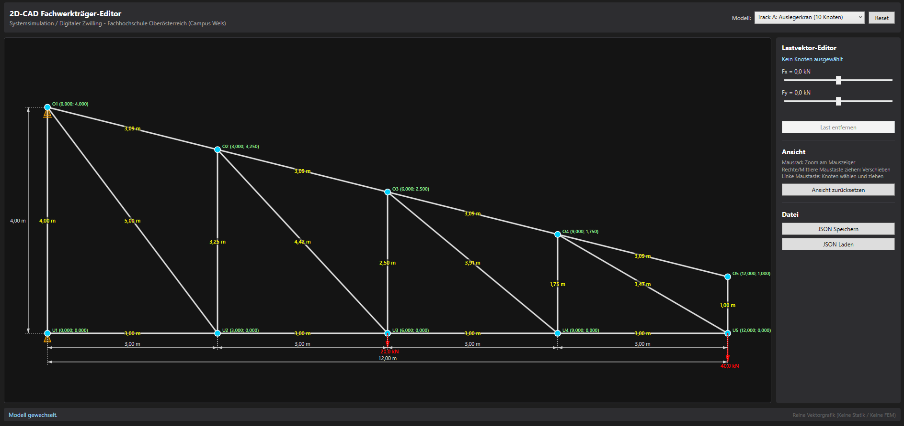
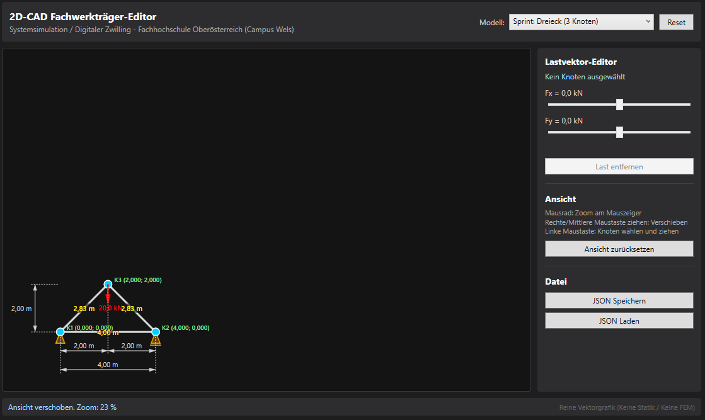

# Termin 03 – Track A: 2D-CAD Fachwerkträger-Editor

**Lehrveranstaltung:** Systemsimulation / Digitaler Zwilling  
**Studiengang:** B.Sc. Automatisierungstechnik, 5. Semester, FH OÖ Campus Wels  
**Technologie:** C# 12 / .NET 8, WPF Canvas, System.Text.Json  

---

## 1. Architektur & Entkopplung (Separation of Concerns)

Das Projekt trennt Geometriedaten, Transformation, Rendering und Benutzerinteraktion vollständig voneinander:

* **Datenmodell (`VectorTrussCanvas.Models`):**
  * `TrussNode`, `TrussBar`, `TrussLoad`, `TrussGeometry`: Reine Datenhaltung in physikalischen Weltkoordinaten [m] und Lasten [kN]. Völlig entkoppelt von Bildschirmkoordinaten oder WPF-Controls.
  * `TrussSerializer`: JSON-Export und Import über schlanke DTO-Records (`NodeDto`, `BarDto`, `LoadDto`) mittels `System.Text.Json`. Beinhaltet semantische Validierung (Prüfung auf doppelte IDs und fehlerhafte Stab-Referenzen).
* **Mathematische Abbildung (`VectorTrussCanvas.Geometry`):**
  * `Transform2D`: Zweistufiges Modell aus isotropem Auto-Fit (`Update`) und Kamera-Transformation (`ZoomAt`, `PanBy`).
  * `VectorArrow`: Analytische Pfeilspitzenberechnung (14 px feste Pixelgröße) via Drehmatrix sowie normgerechte DIN-406 Bemaßungsketten (Hilfslinien, Maßlinie, Pfeile).
* **Darstellung & Performance (`VectorTrussCanvas.Rendering`):**
  * `RenderStyles`: Alle wiederverwendeten Pinsel (`Brush`) sind über `.Freeze()` unveränderlich eingefroren und statisch, was Change-Tracking und Allokationen beim Dragging reduziert.
  * *Hinweis zum Render-Loop:* Die WPF-Shapes (`Line`, `Polygon`, `TextBlock`) werden pro `Redraw()` neu erzeugt. Für Tragwerksmodelle dieser Größe (bis ca. 10 Knoten, 17 Stäbe) gewährleistet dies ein flüssiges, ruckelfreies Arbeiten (für Großsysteme mit N > 1.000 wäre ein Wechsel auf `DrawingVisual` vorgesehen).
  * `TrussRenderer`: Rendert Stäbe, euklidische Stablängen [m], Auflager, Knoten, Lastpfeile und zweistufige DIN-406 Bemaßungen auf den Canvas.
* **Benutzeroberfläche (`MainWindow.xaml.cs`):**
  * Ereignisbehandlung für responsives Drag-and-Drop, Fixpunkt-Zoom per Mausrad, Panning (rechte/mittlere Maustaste) und interaktiven Lastvektor-Editor über Schieberegler.

---

## 2. Mathematische Grundlagen

### A. Affine Welt-zu-Bildschirm-Transformation
* **Isotropes Skalieren (Verzerrungsschutz):**
  `s = min( (w_canvas - 2 · margin_x) / W_welt , (h_canvas - 2 · margin_y) / H_welt )`  [px/m]
* **Y-Invertierung:** Da die Bildschirm-Y-Achse nach unten wächst, Weltkoordinaten jedoch nach oben positiv sind:
  `y_screen = PanY + Zoom · [ OffsetY + (Y_max - y_w) · s ]`
* **Fixpunkt-Zoom (`ZoomAt`):**
  Der Weltpunkt unter dem Mauszeiger `(cx, cy)` bleibt während des Skalierens ortsfest am selben Pixel:
  `Pan' = c - (c - Pan) · (Zoom_neu / Zoom_alt)`

### B. Behebung des Dragging-Jitterings
Wird ein Knoten mit der Maus verschoben (`_draggedNode != null`), wird das Auto-Fit-Update der Bounding Box blockiert. Der Maßstab bleibt starr eingefroren, sodass der Knoten exakt unter dem Cursor verbleibt. Erst beim Loslassen der Maustaste (`MouseUp`) wird das Modell auf die neue Bounding Box eingepasst.

### C. Analytische Pfeilspitzen-Invarianz & Schaftbegrenzung
Die Schaftlänge des Kraftpfeils skaliert proportional zum Kraftbetrag und ist auf 25 bis 130 px begrenzt. Die geschlossene Pfeilspitze (Polygon) wird analytisch über eine Drehmatrix berechnet und behält bei jedem Betrag und Winkel exakt ihre feste Länge von 14 px und ihren Halbwinkel von 15°.

---

## 3. Didaktische Vorgreif-Sperre

Gemäß den Vorgaben für Termin 03 konzentriert sich diese Einheit rein auf 2D-Vektorgrafik und Interaktion:
* Es werden **keine** Steifigkeitsmatrizen, **keine** FEM-Gleichungslöser und **keine** Stabkraftberechnungen durchgeführt (diese folgen erst in Termin 07).
* Es werden **keine** externen Charting-Bibliotheken (kein ScottPlot), kein SharpGL und kein Multithreading eingesetzt.

---

## 4. Tragwerksmodelle & Statische Bestimmtheit

1. **Sprint-Dreieck:** 3 Knoten, 3 Stäbe, 1 Einzellast.
2. **Pratt-Träger:** 8 Knoten, 13 Stäbe, 12 m Spannweite, 2 Obergurtlasten.
3. **Auslegerkran-Träger (Track A):** 10 Knoten, 17 Stäbe, Spannweite 12 m, asymmetrischer Verlauf von 4,0 m auf 1,0 m Höhe.
   * **Lasten:** Nutzlast an der Auslegerspitze (-40 kN) und Zwischenlast in Feldmitte (-20 kN).
   * **Plausibilitätsprüfung (Abzählformel):**
     `b = 2 · k - 3 = 2 · 10 - 3 = 17` Stäbe.
     *Hinweis zur Statik:* Das System ist statisch bestimmt unter der konstruktiven Annahme, dass das Loselager an O1 die horizontale Abstützkraft an der Wand aufnimmt (Wirkungslinie senkrecht zur Wand), während das Festlager U1 die Vertikal- und Horizontallast am Fußpunkt bindet.

---

## 5. DIN-406 Bemaßungsketten

* **Horizontal zweistufig:**
  * *Stufe 1 (innere Kette bei +30 px):* Bemaßung der einzelnen Untergurt-Abschnitte (wird topologisch anhand der 'U'-Knoten geführt und besitzt einen geometrischen Fallback).
  * *Stufe 2 (äußere Kette bei +60 px):* Bemaßung der Gesamtlänge über das gesamte Bauwerk (immer sichtbar).
* **Vertikal links:**
  * Bemaßung der Gesamthöhe bei -40 px (bzw. gestaffelt bei Zwischenhöhen). Maßzahlen sind nach DIN 406 um -90° gedreht und von rechts lesbar.

---

## 6. Grafische Nachweise

### A. Auslegerkran (10 Knoten, 17 Stäbe) mit zweistufiger Bemaßung

### B. Zoom- und Panning-Funktion (Kamera-Steuerung)
