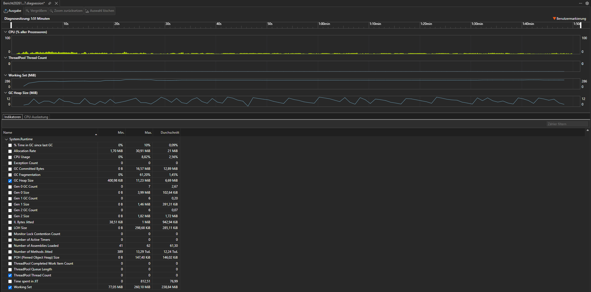
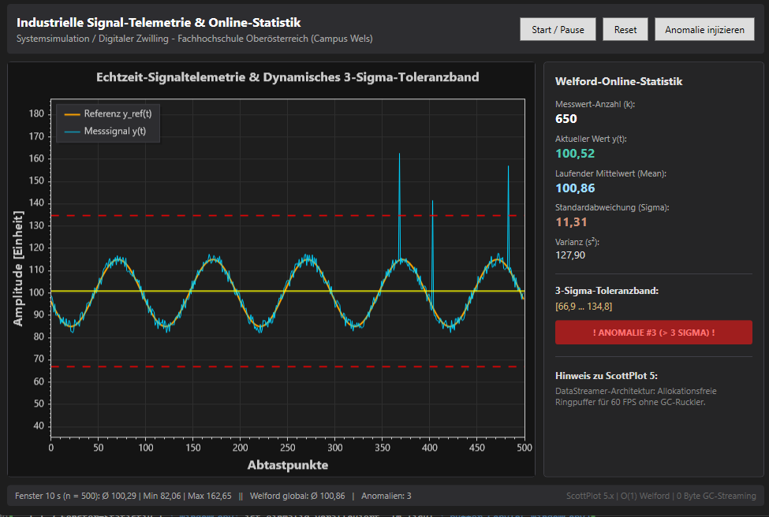
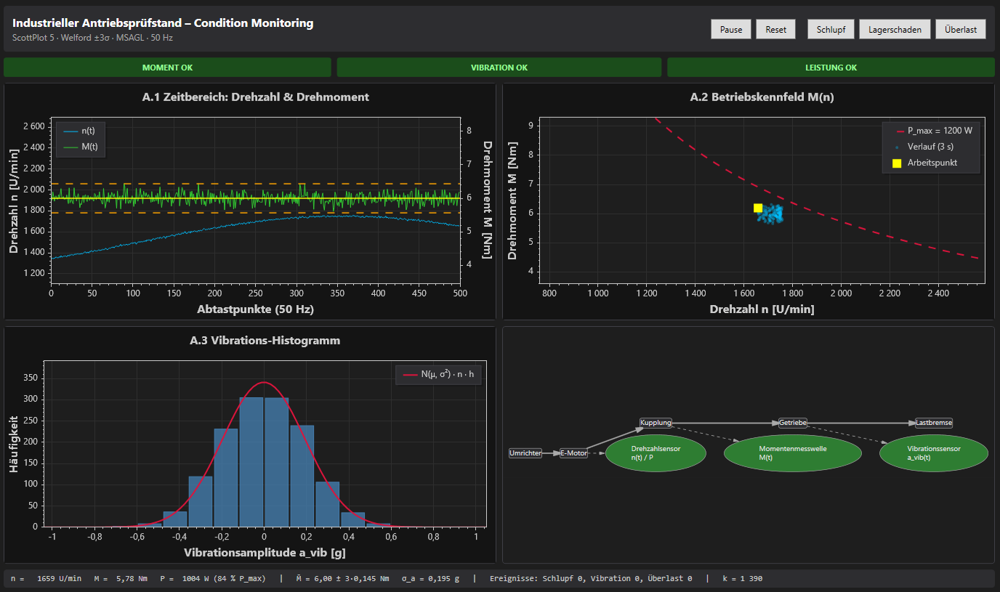
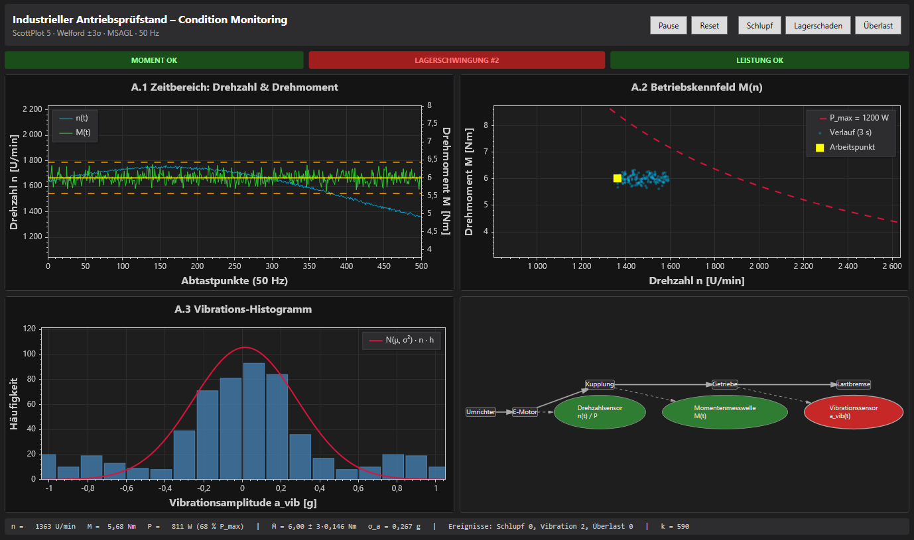

# Hausübung Termin 04 – Telemetrie, ScottPlot 5 & Welford-Statistik

**Lehrveranstaltung:** Systemsimulation / Digitaler Zwilling – FH OÖ Campus Wels
**Bearbeitung:** Einzelabgabe
**Gewählter Track (Stufe 2):** Track A – Industrieller Antriebsprüfstand & Schwingungs-Leitstand
**Technologie:** C# 12 / .NET 8, WPF, ScottPlot.WPF 5.1.59, AutomaticGraphLayout.WpfGraphControl 1.1.12

---

## 1. Projektstruktur

```
ScottPlotTelemetry.sln
├── ScottPlotTelemetry/                 Stufe 1 (Vorlage + Basisaufgabe)
│   ├── Data/CircularBuffer.cs
│   ├── Statistics/WelfordStatistics.cs
│   └── MainWindow.xaml(.cs)            Aufgaben 1.1 – 1.3
├── ScottPlotTelemetry.TrackA/          Stufe 2, Track A (eigenes Projekt)
│   ├── Simulation/TestBenchModel.cs    Signalmodell n(t), M(t), a_vib(t) + Fehlerinjektion
│   ├── Monitoring/ViolationDetector.cs Alarm bei > 3 aufeinanderfolgenden Verletzungen
│   ├── Monitoring/LiveHistogram.cs     Histogramm mit 20 festen Klassen
│   ├── Topology/DrivetrainGraph.cs     MSAGL-Antriebsstrang
│   ├── MainWindow.xaml(.cs)            Dashboard mit 3 ScottPlot-Panels + Graph
│   └── docs/                           Screenshots und Profiler-Ergebnis
└── Tests/TelemetryTests/               Unit-Tests der Vorlage
```

Track A referenziert das Stufe-1-Projekt per Projektreferenz und verwendet dessen `WelfordStatistics` direkt (kein doppelter Code, die Unit-Tests decken die Klasse weiterhin ab).

**Starten:** Gewünschtes Projekt im Projektmappen-Explorer per Rechtsklick → *Als Startprojekt festlegen* → F5.
**Tests:** `dotnet test` im Ordner der Projektmappe.

---

## 2. Stufe 1 – Basisaufgabe

| Aufgabe | Umsetzung |
|---|---|
| 1.1 GC-Leak-Fix | Die vier Badge-Brushes sind `private static readonly`, werden im statischen Konstruktor mit `Freeze()` eingefroren und im Tick nur noch referenziert. Zusätzlich werden sie nur bei einem Zustandswechsel gesetzt. |
| 1.2 Fenster-Statistik | `_windowCopy` ist einmalig vorallokiert. Im Tick: `_buffer.CopyTo(_windowCopy)` und eine `for`-Schleife für Mittelwert, Min und Max der letzten 500 Werte (= 10 s). Bewusst kein `foreach`, weil der `yield`-Enumerator ein Heap-Objekt wäre. |
| 1.3 Entprellung + Referenzkanal | Haltezeit 25 Ticks (0,5 s), Zähler erhöht sich nur bei neuen Ereignissen. Zweiter `DataStreamer` zeigt $y_{\text{ref}}(t) = 100 + 15\sin(2\pi \cdot 0{,}5\,t)$. |

Zusätzlich werden die Textfelder nur mit 10 Hz aktualisiert, da interpolierte Strings immer allokieren.

**Beobachtung zur Vorlage:** Das globale $\sigma$ enthält die Sinusschwankung selbst:

$$\sigma \approx \sqrt{\tfrac{15^2}{2} + \tfrac{6^2}{12}} \approx 10{,}75 \quad\Rightarrow\quad 3\sigma \approx 32{,}2$$

Ein Peak von +45 nahe dem Sinus-Minimum bleibt deshalb unter der oberen Grenze und wird nicht erkannt. Im Screenshot `stufe1.png` ist das gut zu sehen: Der mittlere Peak fiel in die Nähe des Sinus-Tals und lag mit ca. 142 nur knapp über der Grenze von 134,8. Eine Prüfung auf dem Residuum $r = y - y_{\text{ref}}$ würde das beheben.

---

## 3. Stufe 2 – Track A: Antriebsprüfstand

### 3.1 Signalmodell (`TestBenchModel`)

$$n(t) = 1500 + 250\sin(2\pi\cdot 0{,}05\,t) + \varepsilon_n,\quad \varepsilon_n \sim \mathcal N(0,\,5^2)\;[\text{U/min}]$$
$$M(t) = 6 + \varepsilon_M,\quad \varepsilon_M \sim \mathcal N(0,\,0{,}15^2)\;[\text{Nm}]$$
$$a_{\text{vib}}(t) = \varepsilon_a,\quad \varepsilon_a \sim \mathcal N(0,\,0{,}2^2)\;[g]$$

Das Rauschen ist über Box-Muller **normalverteilt**. Die Vorlage nutzt gleichverteiltes Rauschen, dazu würde die Gauß-Kurve im Histogramm nicht passen.

Mechanische Leistung (n in U/min, daher durch 60):

$$P = 2\pi\,\frac{n}{60}\,M \;\le\; P_{\max} = 1200\,\text{W}$$

Im Normalbetrieb liegt der Arbeitspunkt bei maximal ca. 1750 U/min und 6 Nm, also bei etwa 1100 W unter der Grenze.

**Fehlerinjektion per Button:**

| Button | Physik | Wirkung im Modell | Dauer |
|---|---|---|---|
| Schlupf | Kupplung rutscht | $M - 2{,}5$ Nm, $n + 80$ U/min | 15 Ticks (0,3 s) |
| Lagerschaden | Stöße/Kavitation im Lager | $a_{\text{vib}} \pm 0{,}9\,g$ mit wechselndem Vorzeichen | 100 Ticks (2 s) |
| Überlast | Drehzahl weit über Nenndrehzahl | $n + 900$ U/min, damit $P > P_{\max}$ | 150 Ticks (3 s) |

### 3.2 Panels

**A.1 Zeitbereich.** $n(t)$ auf der linken, $M(t)$ auf der rechten Y-Achse, zwei `DataStreamer` mit je 500 Punkten:

```csharp
_torqueStreamer.Axes.YAxis = p.Axes.Right;
_mUpper.Axes.YAxis = p.Axes.Right;   // auch die Bandlinien!
```

Das Band $\bar M \pm 3\sigma_M$ kommt aus der Welford-Statistik. Bei Schlupf werden die Bandlinien rot, und eine `Annotation` blendet einen Warnhinweis ein.

**A.2 Betriebskennfeld.** $M$ über $n$ mit der Grenzhyperbel

$$M_{\max}(n) = \frac{P_{\max}}{2\pi\,n/60}$$

Sie wird einmalig im Konstruktor berechnet. Live verschoben werden nur der Arbeitspunkt-`Marker` (`Location` ist ein Struct) und eine Spur der letzten 3 s. Für die Spur hält `Scatter` eine Referenz auf zwei vorallokierte Arrays, die wie ein Ringpuffer beschrieben werden. Bei Überlast wird der Marker rot.

**A.3 Vibrations-Histogramm.** 20 feste Klassen im Bereich $[-1{,}2;\,1{,}2]\,g$, also $h = 0{,}12\,g$. Die `Bar`-Objekte werden einmal angelegt, im Tick wird nur `.Value` gesetzt. Die Gauß-Kurve nutzt Welford-Mittelwert und -Streuung und wird auf die Balkenfläche skaliert:

$$y(x) = f_{\mathcal N}(x;\,\mu,\sigma)\cdot n \cdot h$$

Die Dichte hat die Fläche 1, die Balken haben die Fläche $n \cdot h$. Ohne die Skalierung wäre die Kurve um den Faktor $n\cdot h$ zu niedrig. Beim Lagerschaden entstehen Seitenkeulen bei $\pm 0{,}9\,g$, die sichtbar von der Glockenkurve abweichen.

**A.4 Anlagentopologie (MSAGL).** Hauptkette `Umrichter → E-Motor → Kupplung → Getriebe → Lastbremse`, Sugiyama-Layout von links nach rechts. Drei Sensor-Knoten sind gestrichelt an ihre Komponente angebunden:

| Sensor | Komponente | Wird rot bei |
|---|---|---|
| Drehzahlsensor (n / P) | E-Motor | Überlast $P > P_{\max}$ |
| Momentenmesswelle (M) | Kupplung | Schlupf |
| Vibrationssensor ($a_{\text{vib}}$) | Getriebe | Lagerschwingung |

Statt `AutomaticGraphLayoutControl` wird direkt der `GraphViewer` verwendet. Beim Umfärben wird so nur der betroffene Knoten invalidiert (`_viewer.Invalidate(vnode)`). Das Control würde stattdessen bei jeder Zuweisung des Graphen das komplette Layout neu berechnen.

### 3.3 Alarmlogik

**Mindestdauer (A.1):** `ViolationDetector` löst erst aus, wenn ein Signal **mehr als 3 aufeinanderfolgende Ticks** verletzt ist. Einzelne Rausch-Ausreißer (bei $3\sigma$ statistisch 0,27 % aller Werte) erzeugen dadurch keinen Fehlalarm. Danach bleibt der Alarm 50 Ticks (1 s) sichtbar.

**Ausreißer gehen nicht in die Statistik ein:** Pro Tick wird erst geprüft und dann eingespeist:

```csharp
bool mViolated = _welfordM.IsAnomaly(m, 3.0);
if (!mViolated) _welfordM.Add(m);
```

Sonst würde jeder Fehler $\sigma$ vergrößern, das Band aufblähen und sich so selbst maskieren. Der Preis dafür: Eine dauerhafte Verschiebung des Arbeitspunkts bleibt als Alarm stehen. Beim Condition Monitoring ist das gewollt, denn eine bleibende Änderung ist ein Befund.

---

## 4. Welford-Algorithmus

Rekursion pro Messwert, in $O(1)$ Zeit und mit 3 gespeicherten Zahlen (`Count`, `Mean`, `M2`):

$$\bar x_k = \bar x_{k-1} + \frac{x_k - \bar x_{k-1}}{k}$$
$$S_k = S_{k-1} + (x_k - \bar x_{k-1})(x_k - \bar x_k)$$
$$s_k^2 = \frac{S_k}{k-1}\quad(k \ge 2), \qquad \text{Band: } \bar x_k \pm 3 s_k$$

Die Lehrbuchformel $\frac{1}{k-1}\left(\sum x_i^2 - \frac{1}{k}(\sum x_i)^2\right)$ subtrahiert zwei fast gleich große Zahlen und löscht dabei Stellen aus. Bei einem Offset von $10^9$ kann die Varianz sogar negativ werden. Welford arbeitet nur mit Abweichungen vom laufenden Mittelwert und ist deshalb stabil. Das belegt der Test `Test_Welford_CatastrophicCancellation_Resistance`.

---

## 5. Allokationsfreiheit im Render-Loop

| Was | Wo angelegt | Im Tick |
|---|---|---|
| WPF-Brushes | `static readonly` + `Freeze()` | nur Referenz zuweisen |
| ScottPlot-Farben | `static readonly` (Structs) | Wertzuweisung |
| `DataStreamer` (2×) | Konstruktor | `Add(value)` in den internen Ringpuffer |
| Spur-Arrays Kennfeld | Feld, `new double[150]` | Inhalt überschreiben |
| `Bar[20]` | Konstruktor | `.Value` setzen |
| Gauß-Arrays | Feld, `new double[120]` | Inhalt überschreiben |
| Histogramm-Zähler | `new long[20]` | `Counts[i]++` |
| Welford (3×) | Feld | 3 `double`-Updates |
| Toleranzband | — | `ValueTuple`, liegt auf dem Stack |

**Was trotzdem allokiert und warum:**

- **Statuszeile und Badge-Texte:** Interpolierte Strings erzeugen neue Objekte. Deshalb wird die Statuszeile nur jeden 5. Tick aktualisiert, die Badges nur bei einem Zustandswechsel.
- **ScottPlot-Rendering:** `Refresh()` erzeugt innerhalb der Bibliothek kleine temporäre Objekte, etwa Views auf die Datenarrays und Pixelpuffer von SkiaSharp. Das liegt außerhalb des eigenen Codes.
- **MSAGL-Umfärbung:** `Invalidate` erzeugt neue Brushes, aber nur bei einem Alarmwechsel, nicht pro Tick.

---

## 6. Performance-Profil

Gemessen mit dem Visual-Studio-Leistungsprofiler (CPU-Auslastung + .NET-Indikatoren), Release-Build, 1:51 min Laufzeit (ca. 3000 Ticks) inkl. aller drei Fehlerinjektionen.

| Messgröße | Min | Max | Durchschnitt |
|---|---|---|---|
| GC Heap Size | 0,4 MiB | 11,2 MiB | 6,7 MiB |
| Allokationsrate | 1,7 MiB | 30,9 MiB | 21 MiB |
| Gen-0-GCs (pro Intervall) | 0 | 7 | 2,7 |
| Gen-1 / Gen-2-GCs (pro Intervall) | 0 / 0 | 6 / 6 | 0,2 / 0,07 |
| Zeit im GC | 0 % | 10 % | 0,09 % |
| CPU-Auslastung | 0 % | 8,8 % | 2,6 % |
| Working Set | 77 MiB | 260 MiB | 239 MiB |

**Interpretation:**
- Der GC-Heap zeigt ein stabiles Sägezahnmuster ohne Aufwärtstrend. Es gibt also **kein Speicherleck**.
- Gen-1/Gen-2-Sammlungen sind selten (im Mittel 0,2 bzw. 0,07 pro Intervall) und treten überwiegend in der Startphase auf (Initialisierung, JIT). Im laufenden Betrieb dominieren billige Gen-0-Sammlungen, die im Mittel 0,09 % der Zeit kosten.
- Die Allokationsrate stammt überwiegend aus dem Rendering von ScottPlot/SkiaSharp (3 Plots pro Tick). Der eigene Tick-Code arbeitet ausschließlich auf vorallokierten Puffern (siehe Abschnitt 5).
- **Effektive Tickrate:** ca. 3000 Ticks in 111 s, also **≈ 27 Hz statt 50 Hz**. Ursache ist die grobe Windows-Timer-Auflösung von ca. 15,6 ms (aus 20 ms werden ca. 31 ms) plus die Renderzeit von drei Plots. Da `_time` pro Tick fest um 20 ms erhöht wird, läuft die Simulationszeit entsprechend langsamer als die Echtzeit.



---

## 7. Screenshots

**Stufe 1 – drei injizierte Anomalien, alle erkannt (Badge „#3“), Fensterstatistik im Footer:**



**Track A – Normalbetrieb:** alle Kanäle grün, Gauß-Kurve deckt sich mit dem Histogramm, $\sigma_M = 0{,}145$ Nm und $\sigma_a = 0{,}195\,g$ entsprechen dem Modell.



**Track A – Lagerschaden:** Vibrations-Badge und Vibrationssensor rot, Seitenkeulen im Histogramm. Moment und Leistung bleiben grün, die Kanäle werden also unabhängig überwacht.



---

## 8. Antworten auf die Leitfragen der Code-Defense

1. **GC-Audit:** Der eigene Tick-Code legt keine Objekte an. Alles ist vorallokiert, Strings werden gedrosselt aktualisiert. Im Profiler steigt der Heap nicht kontinuierlich an, sondern pendelt stabil zwischen ca. 0,4 und 11 MiB (Abschnitt 6). Die verbleibenden Allokationen stammen aus dem ScottPlot-Rendering.
2. **Welford statt naiver Formel:** Es gibt kein LINQ `.Average()` oder `.Sum()`. Alle drei Kanäle nutzen die Rekursion aus `WelfordStatistics.Add` in $O(1)$.
3. **ScottPlot-5-API:** Verwendet werden ausschließlich `Plot.Add.*`, `Plot.Axes.*` und `plottable.Axes.YAxis`. Es gibt keine Aufrufe von `AddSignal`, `XAxis` oder anderen v4-Methoden.
4. **Histogramm-Dynamik:** Balken und Gauß-Kurve werden jeden Tick aktualisiert, die Y-Achse wächst mit. Bei einem Lagerschaden erscheinen sofort die Seitenkeulen.

---

## 9. Bekannte Grenzen

- Das Histogramm zählt global seit dem Start. Mit der Zeit fallen einzelne neue Ereignisse deshalb optisch weniger auf. Ein gleitendes Fenster wäre eine mögliche Erweiterung.
- Das Toleranzband für $M$ ist global. Bei geplanten Lastwechseln müsste es pro Betriebspunkt geführt oder zurückgesetzt werden.
- Beim Lagerschaden liegen einzelne Stoßwerte durch das Rauschen knapp innerhalb von $\pm 3\sigma$ und gehen so doch in die Statistik ein. $\sigma_a$ steigt dadurch leicht an (im Screenshot 0,267 statt 0,2), besonders wenn erst wenige Werte gesammelt wurden.
- Der `DispatcherTimer` erreicht effektiv nur ca. 27 Hz statt nominell 50 Hz (Timer-Auflösung + Renderzeit). Abhilfe wäre eine Entkopplung von Simulation und Darstellung (Folie 48) oder eine Simulationszeit aus einer `Stopwatch` statt fester 20-ms-Schritte. Ein schneller Simulations-Thread war laut Vorgreif-Sperre für Termin 04 jedoch nicht erlaubt.